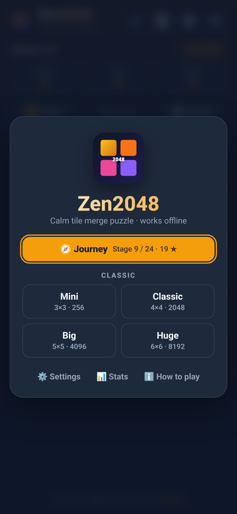
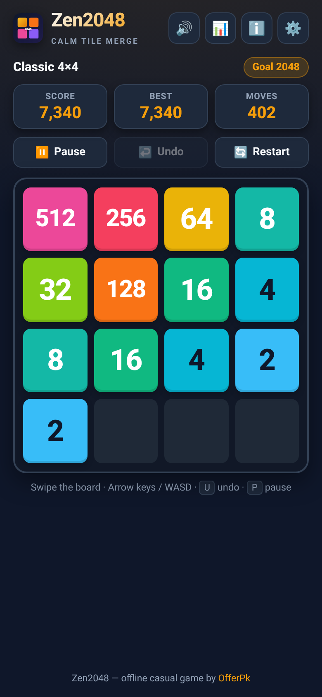
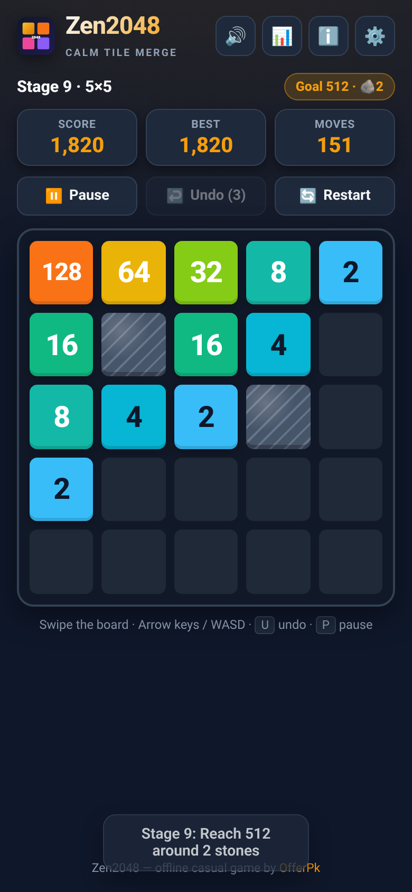
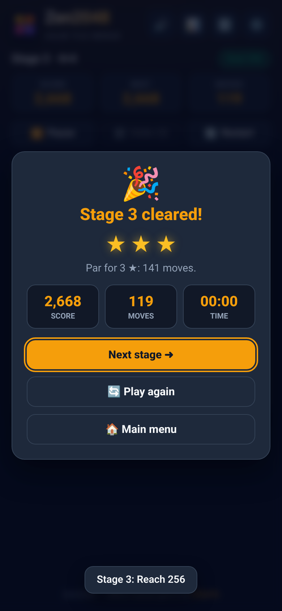
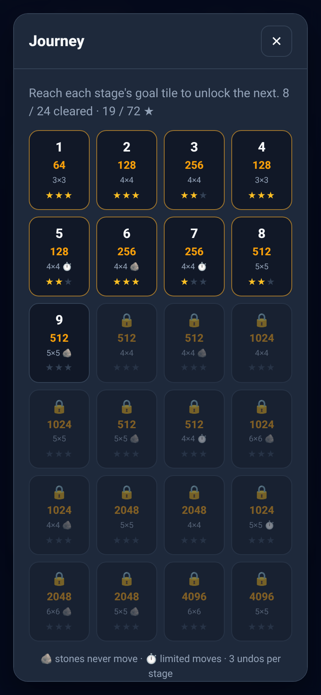
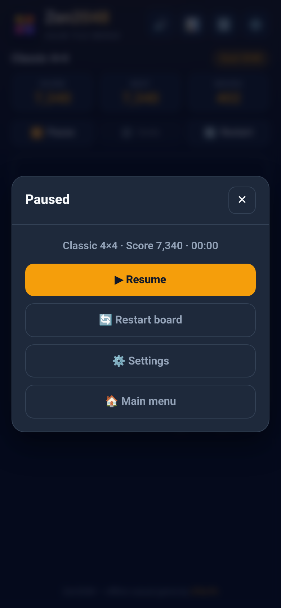
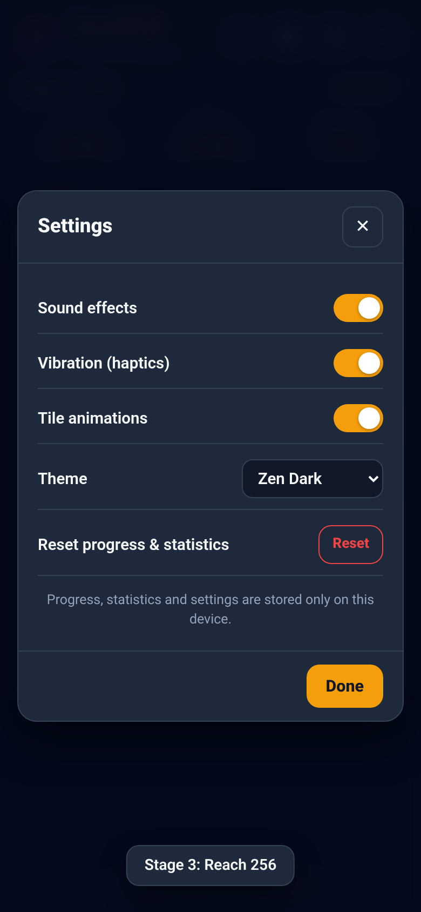
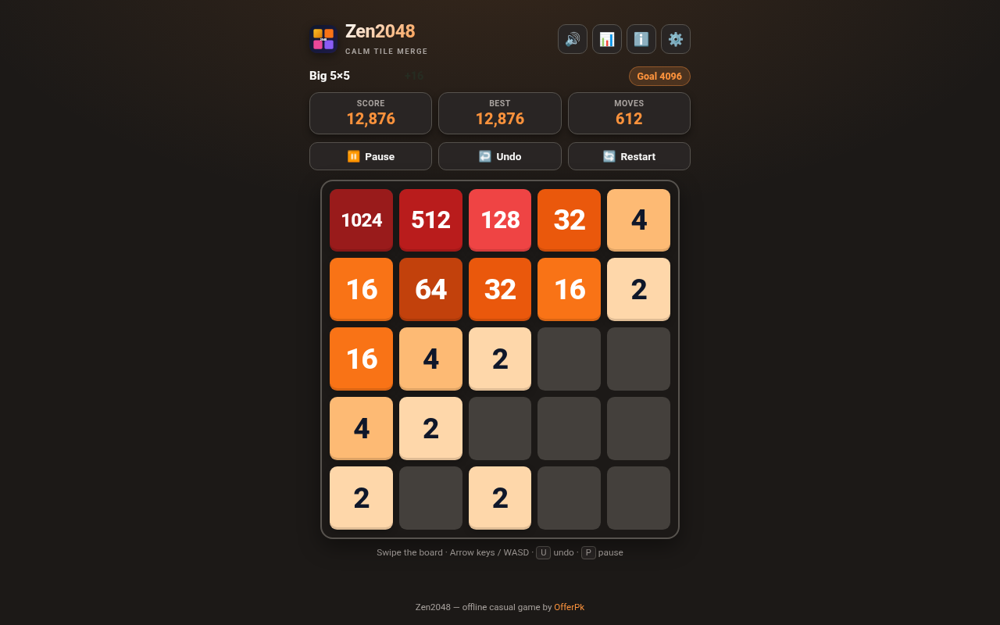

# Zen2048 🧘✨

> A calm, offline 2048 tile-merge puzzle with a 24-stage Journey, four Classic board sizes, smooth slide animations, undo, pause, themes and on-device synthesised sound.

[](https://github.com/OfferPk/zen2048/actions/workflows/ci.yml)
[](https://offerpk.github.io/zen2048/)
[](https://github.com/OfferPk/zen2048/actions/workflows/android.yml)
[](LICENSE)

## 🌐 Live demo

👉 **https://offerpk.github.io/zen2048/** (GitHub Pages preview of `www/`; works offline after the first load and can be installed as a PWA).

## 📱 Android APK

- Every push to `main` builds a debug APK in the [Android build workflow](https://github.com/OfferPk/zen2048/actions/workflows/android.yml) — download the `zen2048-apk` artifact from the latest run.
- Pushing a `v*` tag attaches the APK to a GitHub Release.

## 📸 Screenshots

| Main menu | Classic 4×4 | Journey with stones | Stage cleared |
| :---: | :---: | :---: | :---: |
|  |  |  |  |

| Journey stages | Pause | Settings | Desktop (Sunset theme) |
| :---: | :---: | :---: | :---: |
|  |  |  |  |

## ✨ Features

- **Main menu** — Continue (resumes your auto-saved board), Journey, four Classic difficulties, Settings, Stats and How to play.
- **Journey mode** — 24 stages, each with its own board size and goal tile (3×3 → 64 up to 5×5 → 4096). Later stages add 🪨 **stones** (fixed blocks that never move or merge) and ⏱ **move limits**. Earn 1–3 ★ by moves used vs. par; clearing a stage unlocks the next. 3 undos per stage.
- **Classic difficulties** — Mini 3×3 (goal 256), Classic 4×4 (2048), Big 5×5 (4096), Huge 6×6 (8192). Reach the goal, then *Keep playing* for a record. Unlimited multi-step undo.
- **Controls** — swipe with a finger, drag with the mouse, or use Arrow keys / WASD (also `H J K L`). `U` / `Z` / `Ctrl+Z` undo, `R` restart (two-tap confirm), `P`/`Esc` pause.
- **Pause** — pause button, `Esc`/`P`, Android back button, or switching apps hides the board and stops the clock.
- **Game over / win dialogs** — score, moves, time, stars; *Next stage*, *Keep playing*, *Undo last move* (even after "No moves left"), *Play again*, *Main menu*.
- **Settings** — sound effects, vibration, tile animations, theme (Zen Dark / Sunset Warm / Clean Light), reset progress (two-tap confirm).
- **Sound** — all effects synthesised with the Web Audio API on the device (no audio files, no CDN); quick mute button in the header.
- **Progress in localStorage** — the in-progress board (with undo history), Journey unlocks/stars/best scores, statistics, best score per board, and settings.
- **Responsive** — phones (portrait), tablets and desktop; board scales to the viewport, safe-area aware.
- **AdMob (Android only)** — adaptive banner + an interstitial every 3rd finished game, using **Google's public test IDs only**. The web build never loads ads.

## 🗂 Project layout

```
src/            # source web app (edit here)
  index.html  style.css  game.js (UI/controller)  logic.js (pure rules + levels)  audio.js  ads.js  sw.js
www/            # built web app (copied from src/ by `npm run build`; served by Pages and Capacitor)
android/        # Capacitor Android project (committed)
test/           # logic unit tests + headless browser smoke test
scripts/        # build + icon generation
docs/           # screenshots
```

## 🛠 Run locally

Requirements: Node.js ≥ 20.

```bash
git clone https://github.com/OfferPk/zen2048.git
cd zen2048
npm install
npm run build        # copies src/ -> www/
npm run serve        # http://localhost:8080  (or: cd www && python3 -m http.server 8080)
npm test             # logic unit tests
npm run smoke        # headless Chrome smoke test (needs Chrome/Chromium; set CHROME_PATH if not in /usr/bin)
```

You can also open `www/index.html` directly in a browser (the service worker is skipped on `file://`).

## 📱 Build the Android APK

Requirements: Node.js ≥ 20, JDK 21, Android SDK (API 36) — Android Studio installs both.

```bash
npm install
npm run cap:sync        # build web assets + npx cap sync android
npm run android:build   # cap:sync + ./gradlew assembleDebug
```

Debug APK: `android/app/build/outputs/apk/debug/app-debug.apk`. Open the project in Android Studio with `npx cap open android` if you prefer.

For a Play Store bundle run `npm run android:release` (`./gradlew bundleRelease`) after configuring your own signing key in `android/app/build.gradle` / `~/.gradle/gradle.properties` (never commit keystores or passwords).

CI: every push to `main` builds a debug APK in the **Android build** workflow (artifact `zen2048-apk`). Pull requests run unit tests, the web build and the headless smoke test.

### AdMob IDs

This repo ships **Google sample test IDs only**:

| What | Test ID | Where |
| --- | --- | --- |
| App ID | `ca-app-pub-3940256099942544~3347511713` | `android/app/src/main/res/values/strings.xml` (`admob_app_id`) |
| Banner | `ca-app-pub-3940256099942544/6300978111` | `src/ads.js` |
| Interstitial | `ca-app-pub-3940256099942544/1033173712` | `src/ads.js` |

Before a real store release, replace them with your own AdMob IDs in a private build and set `isTesting: false` in `src/ads.js`. Do not commit real publisher IDs. The web build never loads AdMob.

## 🚀 Deploy `www/` to your own static server

`www/` is a plain static site (HTML/CSS/JS, no server code). Build it, then copy it anywhere:

```bash
npm run build
# Example: copy to a Linux server running nginx
rsync -avz --delete www/ user@your-server:/var/www/zen2048/
```

Minimal nginx site:

```nginx
server {
  listen 80;
  server_name games.example.com;
  root /var/www/zen2048;
  index index.html;
  location / { try_files $uri $uri/ /index.html; }
  location = /sw.js { add_header Cache-Control "no-cache"; }
}
```

Apache, Caddy, Netlify, Cloudflare Pages or any shared host work the same way: upload the contents of `www/` to the web root (or a sub-folder — all paths are relative). Serve over HTTPS so the offline service worker can register. After deploying a new version, bump `CACHE_NAME` in `src/sw.js` so returning players get the update.

## 📄 License

[MIT](LICENSE) © 2026 OfferPk.
